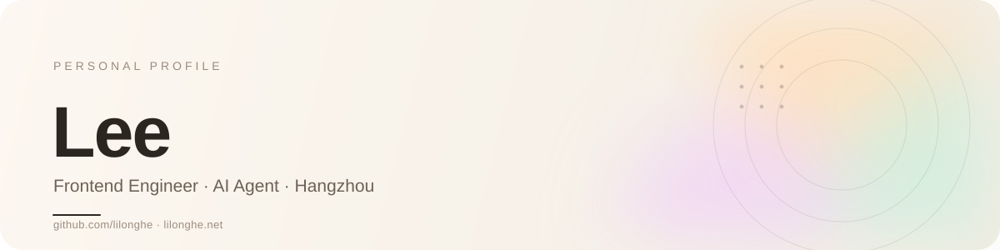

<picture>
  <source media="(prefers-color-scheme: dark)" srcset="./assets/banner-dark.svg">
  
</picture>

### 你好，我是 Lee 👋

前端工程师，近 10 年从页面到服务端的完整落地经验。现在在杭州，做 AI Agent 与 AG-UI；日常用 Claude Code / Codex 写代码，也造一些让开发更顺手的小工具。

### 现在在做什么

- 把 AI Agent 接进真实业务，探索 AG-UI 与 Vibe Coding 的工程化
- 维护 [wex](https://github.com/lilonghe/wex)：一条命令看清本机 AI CLI 的 MCP 和 skills
- 写点东西：[随笔](https://note.lilonghe.net)，记录技术、生活和不成熟的想法

### 技术栈

- **前端** — React · Next.js · Vue · TypeScript · Tailwind CSS · ECharts
- **后端** — Go · Gin · gRPC · MySQL · PostgreSQL · Redis
- **工程化** — Vite · Webpack · Monorepo · Docker · Kubernetes
- **AI** — LangGraph · MCP · AG-UI · Claude Code · Codex

### 找到我

[个人主页](https://www.lilonghe.net) · [博客](https://note.lilonghe.net) · [邮箱](mailto:lilonghe@outlook.com)

Living without an aim is like sailing without a compass.
